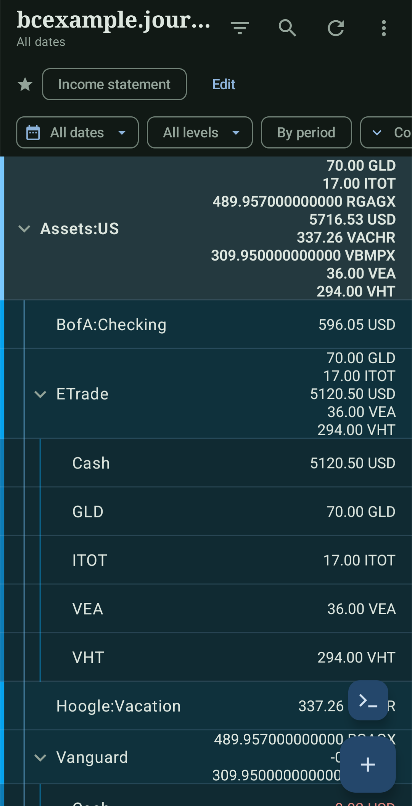
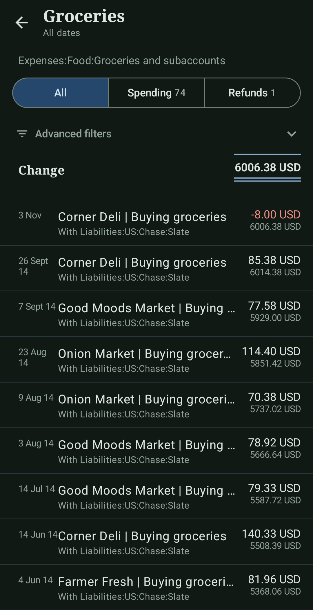
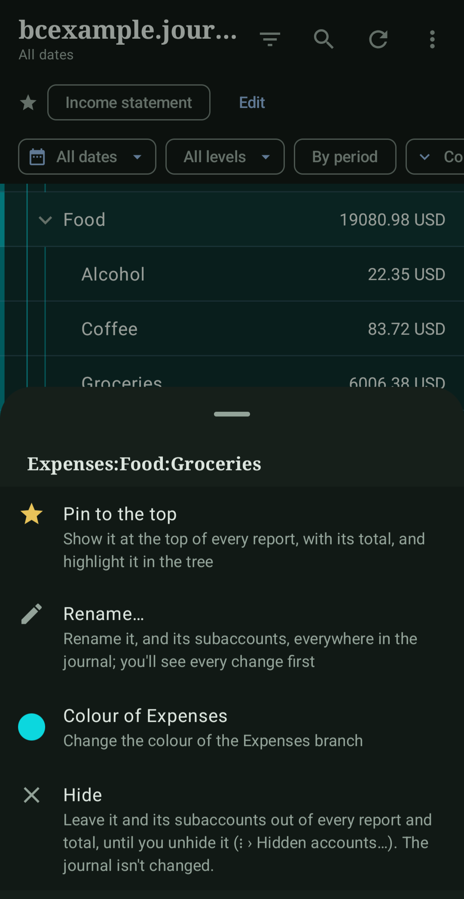
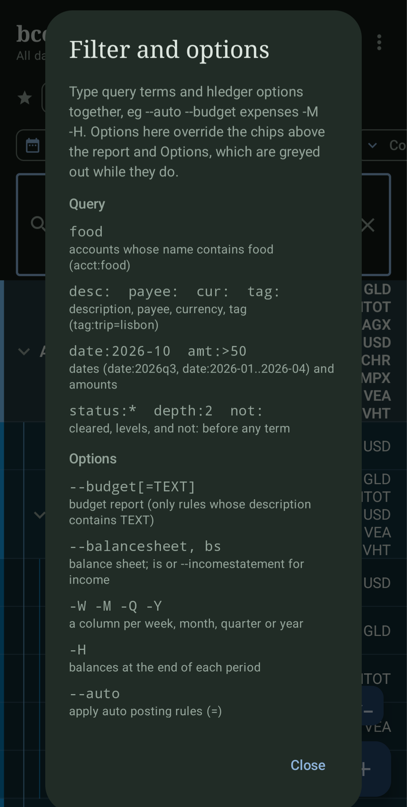
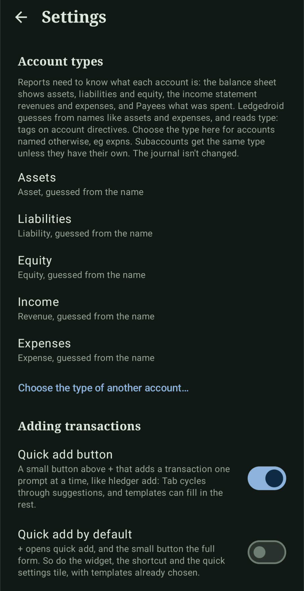
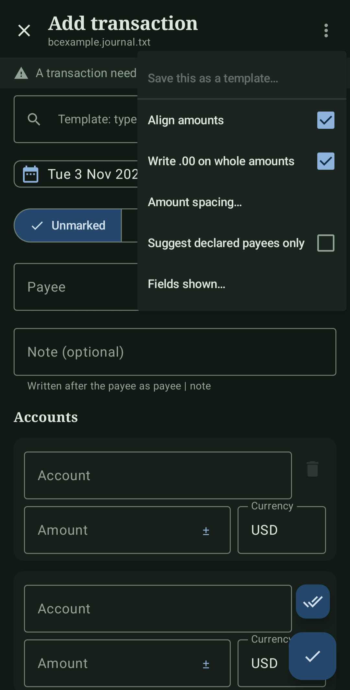
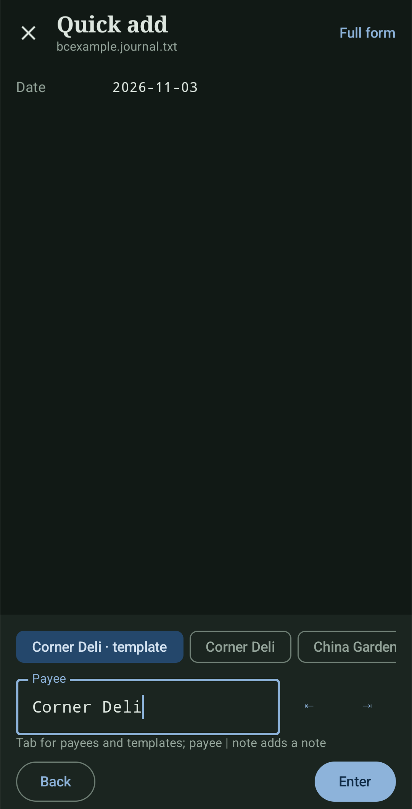
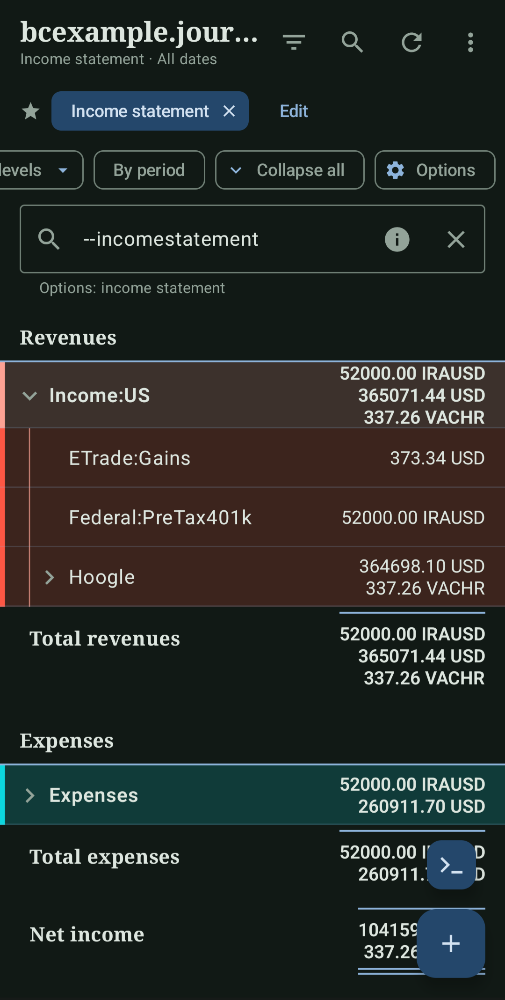
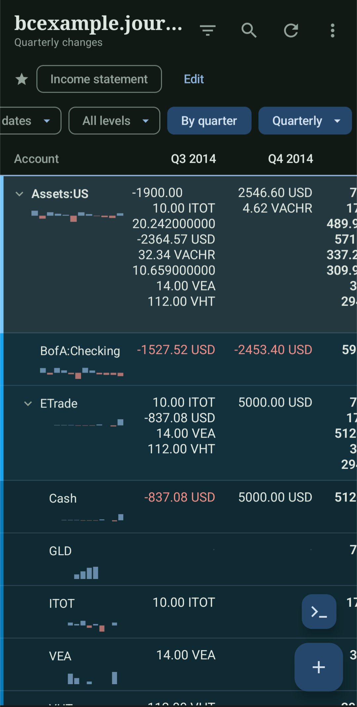

  

<h1 align="center">Ledgedroid</h1>

  A small Android app for <a href="https://hledger.org">hledger</a> journals on your phone.

  
  
  

## NOTE TO USER!
- Ledgedroid is based on hledger, which is free (beer and speech) software maintained
by Simon et al. If Ledgedroid is useful to you, please consider
[sponsoring hledger](https://hledger.org/sponsor.html).
- The app icon was drawn using the beautiful [Aseprite](https://www.aseprite.org/). Buy it and you won't regret it!
- **In addition to GPL 3.0, finances generated from this project and its forks MUST go to hledger.**

## Is this... AI?

TL;DR yes, and I'm sorry if it doesn't sit right with you. You're
welcome to take what you like from it and write your own version by
hand. It's all under GPL 3.0 :)

Besides, I'm not here to flog you anything... just sharing what I
think would be akin to "this helped me, maybe it'll help you too".

Longer version:

I used to love adding transactions to my hledger journal using my very
old vimscripts on phone.

That was until... I missed a few transactions, costing me an absolute
shed load of time to reconcile my ledger. ON MULTIPLE OCCASIONS! I
felt like I was looking for pennies in the sofa...

I work full-time and barely have bandwidth to learn Java / Kotlin to
make a half-decent app. I really tried to not succumb to the AI
pressure, but frankly the time lost reconciling was too much.

So anyway, with a bit of sample code / logic, I managed to get this.

I've been using it for some time and honestly... it's a joy.

Naturally, it's under the GPL 3.0 (+ finances must go to
hledger). Other than that, do what you want with it.

Is it a replacement to hledger? Absolutely not.

Will it save you time when adding transactions on-the-go whilst making
sure your balances are still not atrociously incorrect? Absolutely
yes*.

Any issues, please feel free to report.
 
 
 
Best wishes,

Harvey R., MD

## Quick glance

- Balance, forecast, balance sheet, income statement and budget reports, by
  period, with trend charts
- hledger queries like `desc:`, `amt:>100`, `tag:trip`, and many more typed straight into the filter
- Save commonly used reports/filters
- Set reminders for recurring payments and add them with **one click**
- A full entry form, an `hledger add`-style quick add, **templates**, a
  home screen **widget** and a **quick settings tile**
- Customisable **colours** for each account and its subaccounts
- Pin and hide accounts
- Keep your journal healthy with a **Check**
- **Rename** and **Recategorise** accounts, payees, and transactions rapidly
- Share text/SMS/notifications (eg from bank) and match transactions using RegEx patterns

<table>
  <tr>
    <td align="center" width="25%"> Landing page</td>
    <td align="center" width="25%"> Clicking on an account</td>
    <td align="center" width="25%"> Account options</td>
    <td align="center" width="25%"> Filter options</td>
  </tr>
</table>

<table align="center">
  <tr>
    <td align="center" width="25%"> Settings page</td>
    <td align="center" width="25%"> Add transaction form</td>
    <td align="center" width="25%"> hledger-like Quick add</td>
  </tr>
</table>

<table align="center">
  <tr>
    <td align="center" width="50%"> Income statement</td>
    <td align="center" width="50%"> Balance trend (by quarter)</td>
  </tr>
</table>

## Comparison to other hledger apps

Ledgedroid has a lot of features. Its biggest downside is that it is sadly written
by AI. I can't say that I'm 'proud' of it, but it has certainly helped me and I hope it helps you too.
* The other apps are great and fully deserve your donations.
* I was just in need of something more, which has not been available until now :)
* If Ledgedroid is useful to you, please consider [sponsoring hledger](https://hledger.org/sponsor.html).

| | **Ledgedroid** | **NanoLedger** | **MoLe** |
|---|---|---|---|
| **Purpose** | Viewer + editor focused on reports | Data-entry app | Android front end to hledger-web |
| **Where the data lives** | Local journal file, re-read when you return to the app (works with Syncthing, Dropbox etc.) | Local journal file | An hledger-web server |
| **Server need** | No; all offline | No; all offline | Yes (hledger-web 1.10 or 1.14+) |
| **Supported syntax** | Most of hledger's: periodic and auto posting rules, costs, assertions, virtual postings, `include`, `alias`, `apply account`, `P` prices, account types | ledger/hledger-like, not the full syntax | Whatever hledger-web parses, since hledger reads the file |
| **Balance reports** | `balance`, balance sheet, income statement, budget, multi-period columns, depth, `-H`, `-V`/`-X` valuation, `--forecast`, `--auto` | None; lists transactions only | Hierarchical account list with current balances (seems that reports are planned) |
| **Transaction list + search** | Per-account register with running balance, advanced In/Out split, advanced filters; search with hledger query terms | List of all transactions, search (including by amount) | Transaction list filtered by account name |
| **Adding transactions** | Full form, `hledger add`-style quick add, batch entry, amount arithmetic, autocomplete | Add form with autocomplete for payee, note and accounts | New-transaction form that auto-fills from earlier transactions |
| **Intelligent adding mode** | Feature-ful intelligent mode that allows for predictions and rapid completion of transactions. | No | No |
| **Editing / deleting transactions** | Yes, except transactions with features the form can't show; one-tap status marking for any transaction; Undo | Yes | No (?) |
| **Templates + shortcuts** | Templates, home-screen widget, quick settings tile, app shortcuts, scheduled reminders, share a bank SMS into quick add (using RegEx!) | No, but some are planned | Templates matched against QR codes (clipboard and SMS matching planned) |
| **Journal maintenance** | Rename accounts, recategorise payees, journal health checks (`hledger check`-like) | No | Not applicable as it is done on the server |
| **Safety** | Automatic and scheduled backups, read-back check after every write, recovery copy if a write fails | No | Not applicable (hledger-web writes the file) |
| **Customisation** | Hide/pin accounts, saved reports, branch colours, amount bars, account types | Settings for different journal styles | Multiple profiles |
| **Min Android version** | 8.0 | 8.0 | 5.1 |

## Why no fancy graphs / stats?

I tried them, and they all looked ugly and generic and left too much of a bad AI taste in my mouth.

Ledgedroid should do one thing, and one thing only.

## How to use it

- The main page shows all accounts and their respective balances. It's
  basically `hledger balance`.  For the income statement, balance
  sheet or budget, type `is` (`--incomestatement`), `bs`
  (`--balancesheet`) or `--budget` in the filter (see below). The
  starred **Income statement** chip shows `is` with one tap; tap it
  again to go back.
- There are "chips" at the top which allow you to sort and change the
  views as you please.
- The **Options** chips lets you do the following: apply auto postings
  (`--auto`), tree or list, balance at end of period (`-H`), show zero
  balances (`-E`), sort by amount (`-S`), convert to cost (`-B`), flip
  signs (`--invert`).
- There is a filter icon at the top (looks like a funnel). If you
  click it, a text area will appears allowing you to enter some common
  hledger commands (like `--incomestatement` or `is`, `--balancesheet`
  or `bs`, `--budget`). Tap ⓘ in it for a full list.
- **Saved reports** (menu, or the starred chips above the report): save
  the current report, with its period, options and search, to come
  back to with one tap. The income statement comes as one.
- The magnifying glass is a search function. It searches every
  transaction, newest first. Plain words match descriptions, accounts,
  comments and amounts ("cafe", "4.50"); all the filter terms above
  work too.
- **Hiding accounts**: long-press › Hide removes an account and its
  subaccounts from every report and total (like `not:`). The bar
  showing the hidden count has **Show for now** / **Hide again**. **⋮ ›
  Hidden accounts…** manages the list: a switch and × per account, a
  switch for all, Unhide all (also in ⋮), a switch to turn off the
  bar, and **Keep hidden accounts in totals** (hides rows only; parents,
  totals and transaction lists still include them). The journal is NOT
  changed.
- **Pinning accounts**: long-press › **Pin to the top** lists an account
  under a star at the top of every report, with its total including
  subaccounts (per period, and with goals in the budget). In the tree
  it gets a star and a gold edge. Balance sheets and income statements
  only show pinned accounts that belong to them. **Hide pinned
  accounts at 0** (⋮ by the Pinned heading) omits those with nothing
  to show, and the heading counts them.
- Tap an account for its transactions with a running balance, and a
  transaction for its postings, comments, tags and journal text.
    - When an account has money going both ways in the period, buttons
      show one side, named by type: **In /
  Out** (assets), **Charges / Payments** (liabilities), **Spending /
  Refunds** (expenses), **Received / Reversed** (revenues), **Positive
  / Negative** (others), with counts. The total becomes that side's
  and the equivalent filter (`amt:<0`/`amt:>0`) is shown.
    - **Advanced filters** narrow the list by description or comment
      words, amount (at least/at most), status,
  other account, tag, currency and dates, with suggestions from the
  account's transactions. All must match; the total follows; **Clear**
  removes them. Sides and filters persist when you open a transaction
  and come back.

## Adding, editing and deleting

Tap **+** to add a transaction. Fields autocomplete from the journal;
one amount can be left empty, and amounts can be sums (`12+8`) and
other basic arithmetics. It won't save until it balances. **✓✓** saves
and starts another.

**Quick add** (Settings) works like `hledger add`, one prompt at a
time, with Tab to cycle suggestions and Enter for defaults. Dates can
be `11-02`, `yesterday` or `-3`.

Transactions are appended in the journal's style; ⋮ › **Align
amounts** or **Amount spacing…** changes the layout, and **Fields
shown…** hides unused fields.

Tap a transaction to **Edit**, **Delete** or mark it **Pending** /
**Cleared**. Transactions with features the form can't represent
(codes, costs, assertions, virtual postings…) can be marked but not
edited. Changes are refused if the file changed elsewhere, and
**Undo** reverts the last one. Every write is verified, and the
original is restored if it fails.

**Templates** prefill the form; save from the form's ⋮, manage in the
main menu. Open the form from the widget, quick settings tile or app
shortcut.

## Extra bits

There are widgets which display the "add transaction" templates. There
are also Quick tiles to be added to the notification area.

## Backups

Choose the journal's folder in **Settings**. Options: regular backups, a
backup before each change (on by default), skip if unchanged, how many
to keep, and **Back up now**. Restore by copying a `.bak` file over the
journal.

## Reminders and sharing

You can give a template a schedule (Templates › ⋮ › Remind me…: every
N days, weeks or months, from a date). On the day, a notification
comes, unless a transaction with that payee is already in the journal;
tap it to add from the template (quick add or the form, as set). It's
in **Settings › Notifications**, checked a few times a day and when
the app opens.

You can share a bank SMS, a notification's text or a note to
Ledgedroid, and quick add starts with the amount, currency, date and
payee it found as the first prompts' defaults. It knows common wording
(`charged $4.50 at Corner Cafe on 01/11/2026`, `INR 1,250.00 debited …
to SWIGGY on 31-Oct-26`); dates are read day first unless that can't
be a date, and currencies become the journal's own (`$` or
`USD`). **Settings › Share patterns** adds your own regular expressions,
tried first and in order, with named groups `(?<amount>…)`,
`(?<currency>…)`, `(?<payee>…)`, `(?<date>…)` and `(?<account>…)`; a
pattern can also start from a template. A box there tries a message
against them all.

## Journal support

Supported: `include`; market prices and
valuation (`-V`, `-X`); periodic rules (`~`) and auto posting
rules (`=`, with `*N` and `%account`, applied in order as in hledger);
transaction status, codes, secondary dates and comments; one inferred
amount per transaction, `@`/`@@` costs, `= == =* ==*` assertions and
assignments, `(virtual)` and `[balanced virtual]` postings; either
decimal mark, digit groups, left/right and quoted commodity symbols;
`account` (with `type:`), `commodity` (with `format`), `payee`,
`decimal-mark`, `D`, `Y`/`year`, `alias`, `apply account` and
`comment` directives. Comment lines under a posting belong to it.

Included files are read once the journal's folder is chosen in
**Settings › Included files** (Android only lets an app read files
it's given). Paths follow from the including file's folder, with `*`
and `?` in the last part; `apply account` and comment blocks end with
their file, as in hledger. Included files are read, not changed: their
transactions show everywhere, but edit them where they are.

Not supported: lots, timeclock and timedot. Query terms:
account patterns, `acct:`, `desc:`, `payee:`, `cur:`, `status:`,
`date:`, `amt:`, `tag:`, `depth:`, `not:` (not `date2:`, `code:`,
`real:`, `expr:` and the like).
